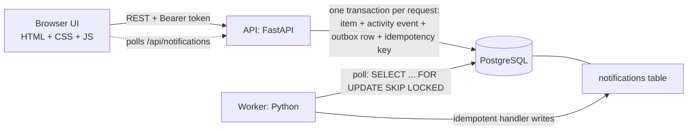

# Ops Desk: Newtonite "Operations Under Pressure"

An internal web app where teams create, assign, track and resolve operational work items
(incidents, customer issues, payments, compliance, tasks). Access is per team and per role, every
important change is recorded in an append-only history, and the interesting parts (claiming,
stale edits, retries, approvals, background notifications) are safe under concurrency.

**Stack:** HTML + CSS + JavaScript (front end, no build step) · Python 3.12 + FastAPI (backend) · PostgreSQL · pytest.

Design choices and trade-offs are in [ENGINEERING_DECISIONS.md](ENGINEERING_DECISIONS.md).

## Run it (one command)

Prerequisites: Docker with Compose.

```bash
docker compose up --build
```

Then open **http://localhost:3000**. Interactive API docs are at http://localhost:3000/api/docs.

This starts Postgres, the API + UI (which migrates the schema and seeds demo data on first start), and the
background worker. Seeding creates 4 teams, 10 users and **5,000 items** so pagination, search and indexes
are exercised for real. To start over: `docker compose down -v`.

### Demo logins (password for all: `password123`)

| Email | Roles |
|---|---|
| `admin@demo.test` | Admin in all 4 teams |
| `lead.pay@demo.test` | Lead in Payments Ops, Member in Platform Incidents |
| `lead.support@demo.test` | Lead in Customer Support |
| `lead.comp@demo.test` | Lead in Compliance, Viewer in Payments Ops |
| `member.a@demo.test` | Member in Payments Ops and Customer Support |
| `member.b@demo.test` | Member in Payments Ops |
| `member.c@demo.test` | Member in Customer Support and Compliance |
| `member.d@demo.test` | Member in Platform Incidents only (an "outsider" to Payments) |
| `viewer.a@demo.test` | Viewer in Payments Ops and Customer Support |
| `multi@demo.test` | Member in Payments Ops, Lead in Compliance, Viewer in Platform Incidents |

The login screen has buttons that fill these in.

### A 2-minute tour

1. Sign in as `member.a@demo.test`, open **Unassigned urgent**, pick an item, press **Claim**.
2. Press **Start work**, then **Send for approval**. Sign out, sign in as `lead.pay@demo.test`, open
   **Awaiting my approval** and **Approve and resolve**. A Member never sees that button, and the API returns 403 if they try.
3. As the Lead, edit an item and assign it to `member.b`. A few seconds later `member.b` has a notification,
   produced by the worker via the outbox.
4. Open the same item in two browser windows, change something in one, then save in the other: you get the
   "this item changed, reload" banner.
5. Sign in as `member.d@demo.test`: none of the Payments items are visible, and requesting one by ID gives 404.

## Run without Docker (optional)

```bash
python -m venv .venv && source .venv/bin/activate      # Windows: .venv\Scripts\activate
pip install -r requirements-dev.txt
# needs a local Postgres; copy .env.example to .env and export its values, then:
python -m app.migrate && python -m app.seed
uvicorn app.main:app --port 3000          # API + UI
python -m app.worker                      # in a second terminal
```

## Run the tests

```bash
docker compose up -d db
pip install -r requirements-dev.txt
pytest
```

`pytest` creates a separate `ops_test` database if needed, applies the migration and runs all 29 tests.
Inside Docker instead:

```bash
docker compose run --rm -e TEST_DATABASE_URL=postgres://postgres:postgres@db:5432/ops_test api sh -c "pip install -q -r requirements-dev.txt && pytest"
```

What the tests prove (each is a real HTTP call against a real Postgres, no mocks):

| Behaviour | Test |
|---|---|
| Two people claim the same item | 5 parallel claims: exactly one 200, four 409, one history entry |
| Stale edit | old `version` is rejected with 409 and the latest item; data unchanged. Two simultaneous edits: one wins |
| Double click / retry | same `Idempotency-Key` (sequential and concurrent) creates one item; reused key with a different body is 422; failures are not cached |
| Workflow | `open -> closed` rejected (409); only a Lead can approve (403 for the creator/Viewer, 404 for another team); full path recorded |
| Authorization | other team gets 404 on every read and write; Viewer gets 403; a Member can't touch an item assigned to someone else; only Leads assign |
| History | events written with the change; a failed request leaves neither change nor event; table is append-only (DB trigger) |
| Async work | job written with the change; duplicate processing yields one notification; retries with backoff then `failed`; crashed-worker recovery; three workers never double-run a job |
| Scale | cursor pagination visits every item exactly once; filters, search and views run in SQL |

## Architecture



* **Request path:** an auth dependency loads the user's team roles from the DB, then each route runs inside one
  database transaction (`app/http.py`) and calls the single permission function in `app/authz.py` before touching data.
* **Data:** `users`, `teams`, `memberships(user, team, role)`, `work_items(... version)`, `activity_events` (append-only),
  `idempotency_keys`, `outbox`, `notifications`. Comments are activity events of kind `comment`.
* **Workflow** (`app/workflow.py`): `open -> in_progress -> awaiting_approval -> resolved -> closed`, plus
  `in_progress -> open`, Lead rejection `awaiting_approval -> in_progress`, and reopen `resolved -> in_progress`.
  Only a Lead/Admin of the item's team may leave `awaiting_approval`.

### Roles

| Action | Viewer | Member | Lead | Admin |
|---|---|---|---|---|
| Read items, history | yes | yes | yes | yes |
| Create, comment, claim | | yes | yes | yes |
| Edit / move an item | | only if unassigned, or assigned to / created by them | any item | any item |
| Approve, assign to others | | | yes | yes |

Roles are per team: a user can be a Lead in one team and a Viewer in another. Non-members get **404** (so the
existence of an item is not leaked); members lacking the right get **403**.

### API

`POST /auth/login`, then `Authorization: Bearer <token>` on:
`GET /api/me`, `GET /api/teams/{id}/members`, `GET /api/notifications`,
`GET /api/items` (`view`, `status`, `priority`, `type`, `team_id`, `assignee`, `q`, `cursor`, `limit`),
`POST /api/items`, `GET /api/items/{id}`, `PATCH /api/items/{id}` (requires `version`),
`POST /api/items/{id}/claim`, `POST /api/items/{id}/transition` (`to`, optional `version`, `note`),
`POST /api/items/{id}/comments`, `GET /api/items/{id}/activity`.
Any write accepts an `Idempotency-Key` header.

## Known limitations

* **Auth is deliberately simple:** seeded users, bcrypt passwords, a 12-hour JWT kept in `localStorage`. No sign-up,
  password reset, rate limiting or lockout. A real deployment would use SSO and httpOnly cookies.
* **No real-time updates.** The list refreshes on demand ("Refresh") and notifications are polled every 10 s.
* **The UI is intentionally plain** and has no automated browser tests. The server-side conflict behaviour it relies on
  (409 plus the latest item) is covered by the API tests; the rollback itself is client code that is not unit-tested.
* **No "four-eyes" rule:** a Lead may approve an item they created or worked on themselves.
* **Notifications are rows in the database**, not emails. The outbox/worker pattern is the same one an email sender would use.
* **Idempotency keys are never purged** and activity history is unpartitioned. Both are fine at this scale (see decisions doc).
* **Search is word-prefix matching** (Postgres full-text, `simple` config), with no typo tolerance or ranking.
* **Admin is "Lead plus reserved for team management"**: there are no team or membership management screens.
* Statuses and transitions are code (`app/workflow.py`), not configurable at runtime.
* The API handlers are synchronous functions that FastAPI runs in a thread pool, with a pool of up to 20 database connections.
  That is plenty here; a much busier service would tune the pool or move to async drivers.

## Next week I would

1. Add a Playwright test for the optimistic-UI rollback and the conflict banner.
2. Per-team configurable workflows and SLA/due-date breach alerts via the same outbox.
3. Four-eyes approval and a reassignment audit view for Leads.
4. Move auth to cookies + SSO, add rate limiting, and purge old idempotency keys with a scheduled job.
5. Partition `activity_events` by month and put search behind a dedicated engine if item counts grow 10x.

## Project layout

```
app/
  main.py            FastAPI app, login, small read endpoints, serves the UI
  http.py            auth dependency + the transaction/idempotency wrapper (run)
  items.py           item routes: create, list, edit, claim, transition, comments, activity
  authz.py           roles, the permission matrix, the one check() function
  workflow.py        the state machine
  outbox.py          transactional outbox + job runner with retry/backoff
  worker.py          the background worker loop
  db.py, migrate.py  connection pool, SQL migrations (app/migrations/*.sql)
  seed.py            demo teams, users, 5,000 items
public/              the UI: index.html, style.css, app.js
tests/               API and outbox tests (pytest)
```
